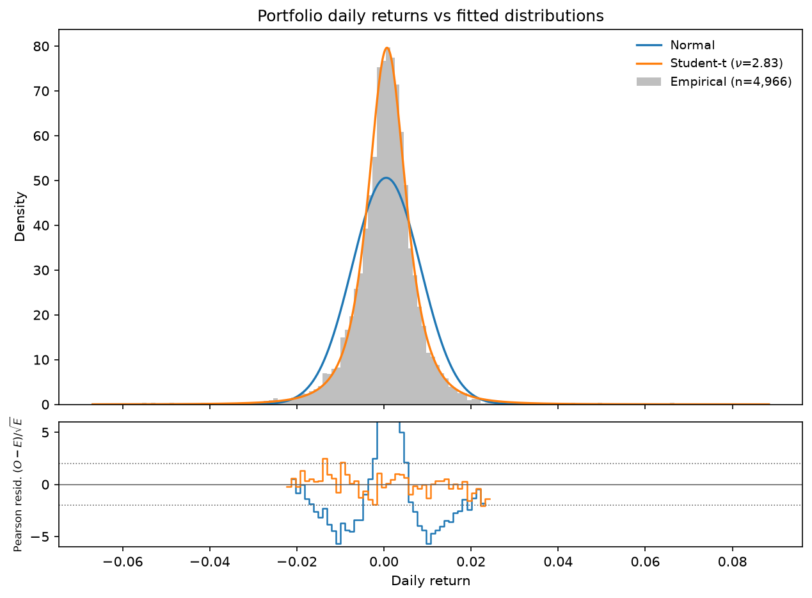
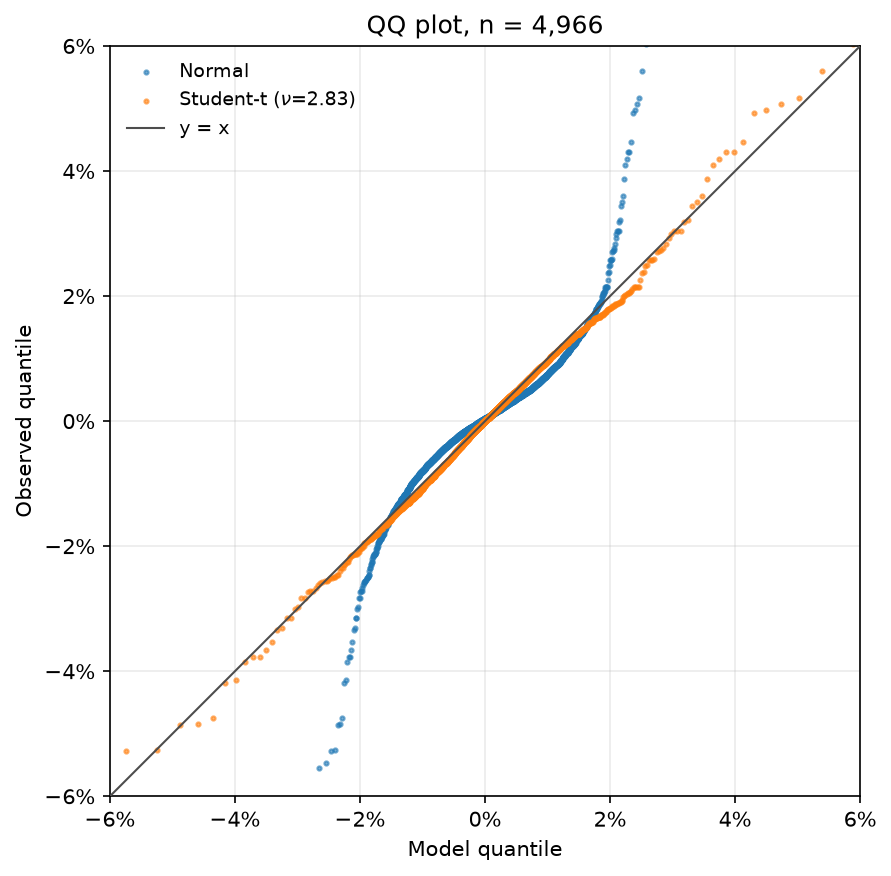
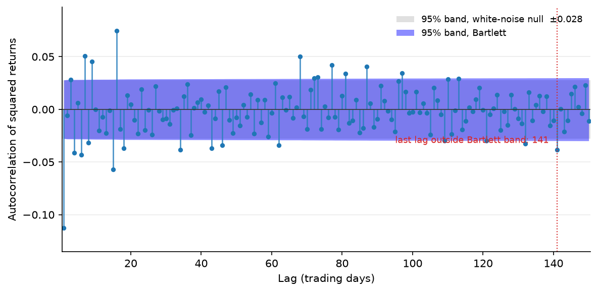
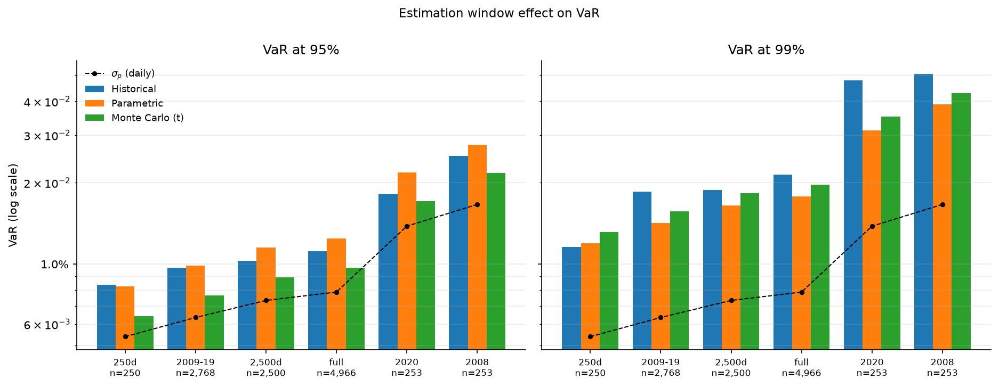

# Market Risk (VaR)
This repo contains a project in market-risk, specifically assessing Value-at-risk (VaR) and expected shortfall (ES) for a given portfolio of equities.
## Summary
A portfolio of 16 assets whose returns were calculated over 4966 trading days was analysed to estimate the value-at-risk and expected shortfall using three methods; historical simulation, parametric, and Monte-Carlo. It was found that the assumption of normality can cause overestimation of the VaR at 95 % and underestimation at 99 %, and is attributable to fatter tails in the sample returns data than can be described by a Gaussian. Backtesting of each approach is in-progress.
## Key Findings
- The parametric method overestimates the VaR at 95 % and underestimates it at 99 % when compared to empirical observations.
- The choice of sampling window has a sizeable effect on the VaR estimates, with the clusters of volatility associated with 2008 and 2020 yielding significantly higher VaR for the portfolio.
- Using bootstrapping with resampling done in blocks of days rather than individual days has shown the parametric and historical method estimations overlap within a 95 % certainty.
- The use of a Student-t distribution matches the historical ES at 99 % but undershoots the 95 % VaR.
- The Monte-Carlo with a Gaussian sampling distribution reproduces the parametric closed form solution as expected.

## Data and Portfolio
The data used in this project was sourced using the yahoo-finance API yfinance, and consisted of the daily closing prices of 16 assets spanning from January 1st 2007 to October 1st 2026 (4966 trading days). The model portfolio was constructed by weighting each asset according to the values found in the below table.

| Ticker | Weight | Ticker | Weight |
| :---:  | :---:  | :---:  | :---:  |
| AAPL | 5 % | MSFT | 5 % |
| AMZN | 5 % | JPM | 5 % |
| GS | 5 % | XOM | 5 % |
| CVX | 5 % | JNJ | 5 % |
| PFE | 5 % | PG | 5 % |
| KO | 5 % | CAT | 5 % |
| NEE | 5 % | WMT | 5 % |
| TLT | 20 % | GLD | 10 % |

Table 1: List of the portfolio tickers and the assigned weights used in this project.

## Portfolio Returns Diagnostics
A first step in the analysis is to characterise the properties of the returns data. This will assist in understanding if any of the assumptions made in the estimation methods are likely to fail, and also provide context for why different approaches might yield different results. A first look at the portfolio returns data, plotted as a normalised histogram in figure 1, shows a bell-shape distribution. 

*Figure 1: Normalised histogram of the portfolio returns data. Plotted alongside the data is a Gaussian distribution with the mean and variance extracted from the data, and a student-t distribution whose parameters were determined using MLE. Shown below is the Pearson residual of both curves with the data.*

*Figure 2: QQ plot showing the predicted and observed values for the quantiles from both the Gaussian model and the Student-t model. The 45 degree diagonal line represents where the predicted and observed quantiles match. The Gaussian predictions were made using the sample mean and std, and the Student-t parameters were all estimated from the MLE of the sample data seen in figure 1.*

Whilst the sample is bell-shaped, the fit produced by the Gaussian model inadequately describes the tails of the distribution. The failure of the Gaussian fit is likely due to the inability of a single parameter $\sigma$ to describe the returns volatility across the entire time series. In order to better model a varying volatility, a Student-t distribution was also fit to the sample.  This allows us to pool normal distributions of varying widths, following more closely the process of daily volatility variations seen in asset returns.

Further evidence for deviation from the assumption of normality in the data can be found in the QQ-plot shown in figure 2.  In this plot the Gaussian traces an S shape which is characteristic of underfitting in a fat-tailed sample, falling below the line on the left and above it on the right indicating real losses are larger than the model predicts. The Student-t tracks the line far more closely, but curls above it in the extreme left tail, overstating the severity of the very worst days with teh fitting parameter $\nu = 2.83$.

Application of the Jarque-Bera test for normality, a test which is particularly powerful at sample sizes comparable to the sample size in question, also indicates the normality assumption will yield inaccurate results. The test statistic, described below where $S$ denotes the sample skewness and $K$ is the excess kurtosis, asks whether the samples skewness and excess kurtosis are jointly consistent with a normal distribution. 

$$ JB = \frac{n}{6}\left(S^2 + \frac{K^2}{4}\right) $$

The test statistic for the sample is over 36,000, orders of magntitude beyond the theshold value to accept the null hypothesis that the sample is normally distributed,
Table 2 lists various properties of the sample returns data, with the sample skewness and kurtosis being calculated for the entire data array using the pandas dataframe methods. Taken at face value, the sample skewness of $0.2255$ would imply larger positive swings than negative, a positive sign for the portfolio. Bootstrapping the returns data to estimate a confidence interval for the sample skewness at a 95\% confidence level produces a range of $[ -0.534, 1.04 ]$, encompassing zero. Removal of the 10 most extreme returns values in either direction produces a skewness of $-0.0554$, and the Bowley quartile skewness yields a value of $-0.0207$, indicative that the distribution is closer to symmetric than the sample value suggests.

Similar analysis of the sample kurtosis, nominally at $13.36$, produces a range of $[ 8.80 - 18.51 ]$. Whilst poorly defined, the range does not cover the value associated with a normal distribution, and this is a strong indicator that the deviation from normality of the sample returns data is almost entirely due to the fat tails in both direction. Breaking down the Jarque-Bera test statistic into its two components for skewness and kurtosis, the kurtosis makes up over 99 % of the value.

| Parameter | Value | 
| :---:  | :---:  |
| $\mu_{p, daily}$ | $0.053$ % |
| $\sigma_{p, daily}$ | $0.788$ % |
| $\mu_{p, annual}$ | $13.3$ % |
| $\sigma_{p, annual}$ | $12.5$ % |
| Skewness | $0.2255$ |
| Kurtosis | $13.36$ |

Table 2: Outline of the sample diagnostics results.

A final diagnostic of the data is a challenge to the assumption that daily returns are independent. Calculation of the autocorrelation of the returns data sample with a lag parameter $k = 1$ yields a value of $-0.113$, suggesting weak short-horizon reversal. To provide an estimate in the uncertainty for this value, bootstrapping can only be applied to where the resampling is done in  blocks > 1, given that shuffling the data day by day would destroy any evidence of autocorrelation. The bootstrapping done with $k = 1$ and block length $20$ results in a 95 % confidence range of $[-0.169 : -0.046]$, meaning the returns are not independent at the first moment. This autocorrelation is very short lived however, since recalculation of the autocorrelation with $k = 2$ gives a value of $-0.006$ and a 95 % confidence interval of $[-0.089 : 0.084]$. A stronger signal for dependence can be seen in the autocorrelation of the square of the returns, which produces a value of $0.301$ with a 95 % confidence interval (block length 20) of $[0.141 : 0.456]$. This autocorrelation decays much slower with increasing lag, with lag values all the way to 130 plotted in figure 3.

*Figure 3: Plot of the autocorrelation of the square of the returns data.*

## Methodologies
Implemented in this repo are the three main methods for estimating VaR and ES, namely historical simulation, parametric (variance-covariance), and Monte-Carlo simulation methods. Alongside these methods is a bootstrap implementation to provide a confidence interval for each estimated parameter. Given that this is time-series data and volatility is likely to be clustered around certain regions, the bootstrap implementation allows for the data to be resampled in blocks to preserve correlation between instances in time. 
### Historical Simulation
Historical simulation makes no parametric assumption about the return distribution. Each day's vector of asset returns is treated as one scenario for what tomorrow could look like; applying the fixed portfolio weights to every historical day gives an empirical distribution of 4,966 possible portfolio outcomes.

VaR at confidence level c is the quantile of that distribution at probability 1 − c. At c = 95%, VaR is the loss exceeded on only 5% of historical days. If for example the VaR was determined to be 2 % of portfolio value, this would translate to a 20,000 risk on 1m. Expected Shortfall is the mean of the losses beyond that boundary: reflecting how severe the tail is once it is breached, which VaR alone does not capture.

The method inherits whatever the sample contains. It makes no distributional assumption, but it does assume that returns are independent and identically distributed and that the historical period is representative of the future.

### Parametric Estimation
In this method, an underlying normal distribution to the portfolio returns is assumed. In order for this to be true, the individual asset returns must be jointly normal, since any linear combination of normal distributions is itself a normal distribution. Pairing this assumption with the variance-covariance matrix $\Sigma$ which is easily determined from the data, estimation of VaR becomes trivial. If $r_{t}$ denotes the vector of returns after day $t$, then the portfolio return $r_{p,t}$ is found by multiplying by the vector of weights $\mathbf{w} \in \mathbb{R}^{k}$ (where $k = 16$, $\sum_i w_i = 1$):

$$r_{p,t} = \sum_{i=1}^{k} w_i \, r_{i,t} = \mathbf{w}^\top \mathbf{r}_t$$

Taking expectations gives the portfolio mean, and the variance follows from the
covariance matrix $\Sigma$, where $\Sigma_{ij} = \mathrm{Cov}(r_i, r_j)$:

$$\mu_p = \mathbf{w}^\top \boldsymbol{\mu} = \sum_{i=1}^{k} w_i \mu_i$$

$$\sigma_p^2 = \mathbf{w}^\top \Sigma \, \mathbf{w}
= \sum_{i=1}^{k}\sum_{j=1}^{k} w_i w_j \, \Sigma_{ij}
\qquad\Longrightarrow\qquad
\sigma_p = \sqrt{\mathbf{w}^\top \Sigma \, \mathbf{w}}$$

With $\Phi^{-1}$ the inverse standard normal CDF and $\varphi$ its density, the
loss quantile at confidence level $c$ and the corresponding Expected Shortfall
are

$$\mathrm{VaR}_c = \sigma_p \, \Phi^{-1}(c) - \mu_p, \qquad
\mathrm{ES}_c = \sigma_p \, \frac{\varphi\!\left(\Phi^{-1}(c)\right)}{1-c} - \mu_p$$

Both are expressed as positive losses. The $-\mu_p$ term accounts for the portfolios positive expected return: a loss is measured from zero, so the expected gain offsets part of it. 

### Monte-Carlo Simulations
The assumption of normality in the parametric method can often fail due to the inability of Gaussian distributions to adequately describe fatter tails in returns data. Using Monte-Carlo simulation methods, other distributions can be utilised. It becomes possible to 
separate the requirement that asset prices are likely to move together from the ability of the model 
to describe how large individual price movements can be. 
By using the correlation structure derived from the data in $\Sigma$, it is possible to 
generate correlated returns across the portfolio that follow other distributions. 

The algorithm:

1. Estimate $\Sigma$ and $\boldsymbol{\mu}$ from the asset returns
2. Factor $\Sigma = LL^\top$ by Cholesky decomposition
3. Draw an $N \times k$ matrix of standardised values $\mathbf{Z}$ with $\mathrm{Cov}(\mathbf{Z}) = I$
4. Form scenarios $\mathbf{R} = \boldsymbol{\mu} + \mathbf{Z}L^\top$
5. Apply the weights and read VaR and ES off the resulting $N$ portfolio returns (utilising the same logic as the historical method)

Step 2 works because the covariance of a linearly transformed vector is

$$\mathrm{Cov}(L\mathbf{z}) = L\,\mathrm{Cov}(\mathbf{z})\,L^\top = LL^\top = \Sigma$$

so the lower-triangular factor converts independent swings into correlated ones
with the exact target covariance. This is only true if the random draws are standardised, which is why $\mathrm{Cov}(\mathbf{Z}) = I$ is a requirement of step 3. 
## Results
### Estimates

| Strategy             | Estimate   | Bootstrap CI (95%)   |   Estimate Confidence Level |
|:---------------------|:-----------|:---------------------|----------------------------:|
| Historical           | 1.117%     | [1.055% - 1.185%]    |                        0.95 |
| Parametric           | 1.244%     | [1.174% - 1.316%]    |                        0.95 |
| Monte Carlo (Normal) | 1.245%     | [1.162% - 1.304%]    |                        0.95 |
| Monte Carlo (t)      | 0.979%     | [0.899% - 1.014%]    |                        0.95 |
| Historical           | 2.144%     | [1.922% - 2.463%]    |                        0.99 |
| Parametric           | 1.782%     | [1.688% - 1.887%]    |                        0.99 |
| Monte Carlo (Normal) | 1.782%     | [1.670% - 1.866%]    |                        0.99 |
| Monte Carlo (t)      | 1.978%     | [1.814% - 2.031%]    |                        0.99 |

Table 3: Estimates for the VaR obtained using each method.

| Strategy             | Estimate   | Bootstrap CI (95%)   |   Estimate Confidence Level |
|:---------------------|:-----------|:---------------------|----------------------------:|
| Historical           | 1.817%     | [1.692% - 1.955%]    |                        0.95 |
| Parametric           | 1.574%     | [1.489% - 1.666%]    |                        0.95 |
| Monte Carlo (Normal) | 1.575%     | [1.472% - 1.646%]    |                        0.95 |
| Monte Carlo (t)      | 1.689%     | [1.561% - 1.743%]    |                        0.95 |
| Historical           | 3.206%     | [2.811% - 3.628%]    |                        0.99 |
| Parametric           | 2.049%     | [1.942% - 2.170%]    |                        0.99 |
| Monte Carlo (Normal) | 2.047%     | [1.919% - 2.143%]    |                        0.99 |
| Monte Carlo (t)      | 3.195%     | [2.953% - 3.284%]    |                        0.99 |

Table 4: Estimates of the ES obtained using each method.

### Interpretation
In order to better quantify the VaR and ES figures, a nominal total portfolio value of €1 million will be considered. This means that according to the historical method the total VaR at 95 % (1.117 %) is €11,168; ES  (1.817 %) is €18,167. At 99 % the Var and ES are (2.144 %) €21,438 and (3.206 %) €32,061. Since these values are derived empirically from the data with no *a priori* assumptions about the underlying distibution, these values serve as a useful reference against which we can compare the other approaches. Looking first to the parametric method and its assumption of normality, the 95 % VaR of €12,443 is an 11.4 % over estimation, and the 99 % VaR of €17,816 is a 17 % underestimation. This is further evidence of the Gaussian distribution being an incorrect match for the shape of the returns data. The implications this has for the ES is drastic, with the ES at 99 % being a 36 % understatement (2.05 % for the parametric vs. 3.21 % for the historical). This means that 1 % of the time the average losses will be far greater than expected under the parametric scheme.

Looking to the Monte-Carlo framework, the method which leveraged a Gaussian to provide the random samples of correlated returns matches the VaR and ES of the parametric in both the 95 % and 99 % levels, confirming the underlying machinery is working since they rely on the same assumption of normality. With this framework validated, the results from then Student-t distribution can be discussed. There is much better agreement on the ES at 99 % compared to the historical method, 3.195 % vs. 3.206 %, however the stretching of the distribution to account for the tail losses has the effect of thinning the body of the curve, resulting in a 12 % underestimation of the VaR at 95 % when compared to the historical. 

Whilst this analysis is useful in understanding how the different approaches compare to the empirical observations, the true validation of which model is correct will come from rigorously back testing each approach. To highlight this, a plot of VaR estimated using the different methods can be seen in figure 4. The VaR estimates for two known periods of high volatility, 2008 and 2020, are significantly higher than the full sample estimate, which is itself higher than the relatively calmer period of 2009-2019.

*Figure 4: Plot highlighting the effect sample window has on the value at risk estimate. The volatility clusters associated with 2008 and 2020 produce significantly different VaR estimates than the calmer periods of 2009-2019. The full window result sits somewhere in between these two extrema.*

This volatility clustering also has an impact on the calculation of the confidence interval for the VaR using different methods. The parametric and historical methods appear to yield distinct values within uncertainty at a 95 % confidence interval if we estimate the confidence interval using boostrapping with a block length of 1. If however some clustering is preserved during the resampling, these confidence intervals widen, and an overlap begins when the block length is set to 3. Figure 5 shows the widening confidence intervals calculated using bootstrapping with increasing block length.

*Figure 5: Plot of the widening 95 % confidence intervals for the VaR at 99 % confidence for both the historical and parametric methods.*

### Limitations
There are several limitations of this analysis which must be noted. The first and foremost is that the application of each VaR estimation technique utilises empirical observations to produce static models. The assumption here is that historical performance serves as an indication of future performance which of course may not always be the case. The second limitation is in estimation fo $\nu$, the scale for the Student-t distribution. In the above analysis this was derived from fitting the data with free parameters, however it is also possible to fix the center of the distribution to 0 or to the sample mean, and this will produce different results. The third issue is when we estimate VaR and ES from shorter windows, such as the 250-day estimate. Whittling the sample down to 250 days results in far less data in the tails, decreasing the accuracy with which the parameters can be determined.

## Back Testing
This work is in progress and will be updated soon.